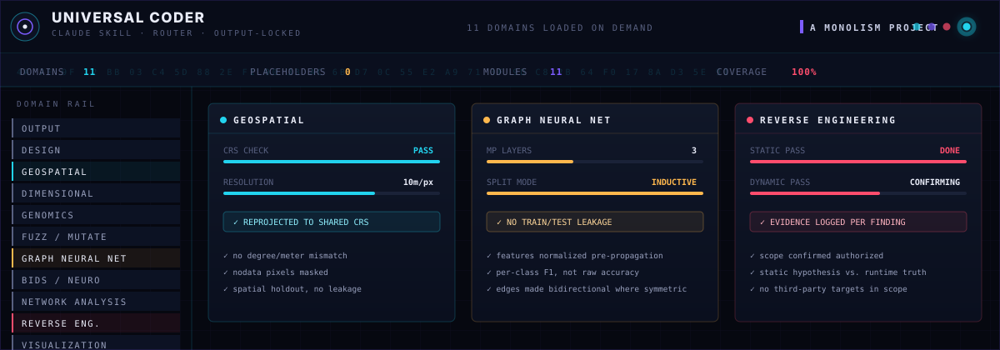
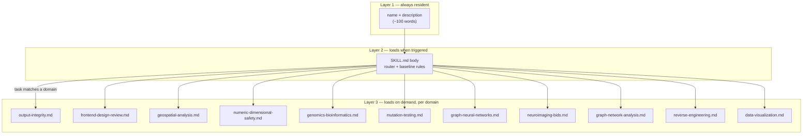
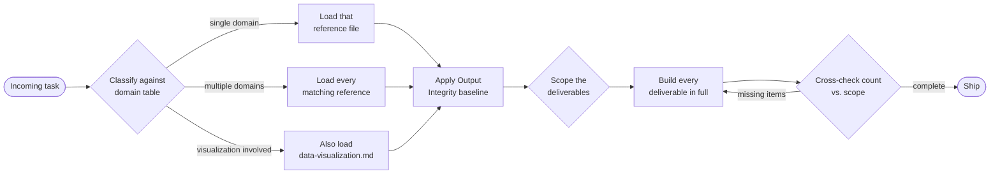
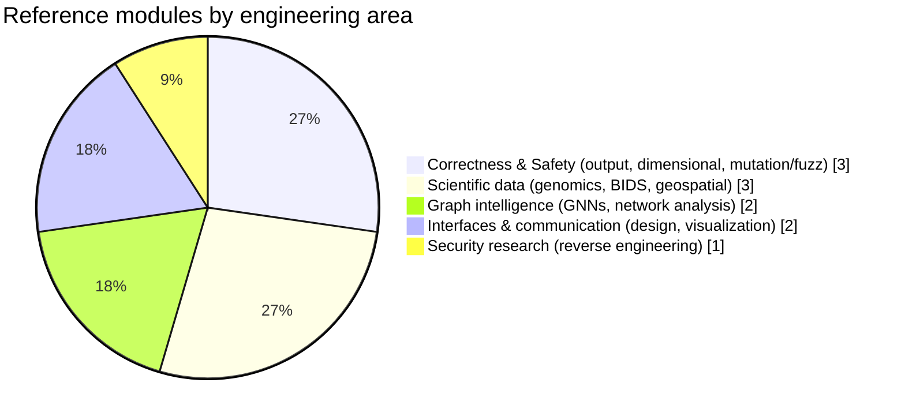
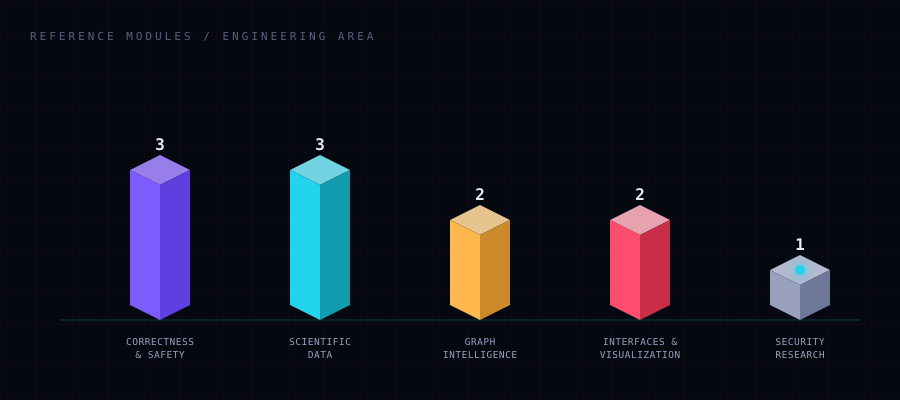

<p align="center">
  
</p>

<h1 align="center">Universal Coder</h1>

<p align="center">
  A single, installable <a href="https://www.anthropic.com/news/skills">Claude Skill</a> that
  consolidates eleven specialist engineering disciplines — plus a hard no-placeholders output
  guarantee — into one coherent, progressively-disclosed workflow.
</p>

<p align="center">
  
  
  
  
</p>

---

## Why this exists

Most skills are narrow on purpose — that's correct design for a single workflow. This repo
takes the opposite bet: it's a **router skill**. One small `SKILL.md` always stays in context,
classifies the incoming task against eleven domains, and pulls in only the reference
file(s) that actually apply. You get the depth of eleven specialist skills without paying the
context cost of loading all of them on every request.

The one rule that is never optional, regardless of domain: **no placeholders, no truncated
files, no "rest follows the same pattern."** Every deliverable ships complete.

## Architecture



This is the same three-level progressive-disclosure model every well-built Claude Skill uses —
metadata is always cheap, the SKILL.md body loads once relevance is detected, and the heavy
domain-specific playbooks only load when the task actually needs them.

## Request-routing flow



## Domain coverage



<p align="center">
  
</p>

## What's inside

| # | Domain | Reference file | Covers |
|---|---|---|---|
| 0 | **Output Integrity** *(always active)* | [`output-integrity.md`](skills/universal-coder/references/output-integrity.md) | Banned placeholder patterns, scope-lock/build/cross-check loop, clean pause/resume on long outputs |
| 1 | Frontend / UI design review | [`frontend-design-review.md`](skills/universal-coder/references/frontend-design-review.md) | Hierarchy, spacing, typography, color tokens, responsive + motion review, anti-patterns |
| 2 | Geospatial analysis | [`geospatial-analysis.md`](skills/universal-coder/references/geospatial-analysis.md) | CRS correctness, raster/vector toolchains, STAC/COG workflows, spatial-ML leakage |
| 3 | Numeric / dimensional safety | [`numeric-dimensional-safety.md`](skills/universal-coder/references/numeric-dimensional-safety.md) | Unit/decimal annotation, dimensional algebra, DeFi/fixed-point bug patterns |
| 4 | Genomics / bioinformatics | [`genomics-bioinformatics.md`](skills/universal-coder/references/genomics-bioinformatics.md) | FASTA/BAM/VCF handling, coordinate conventions, reference-build discipline |
| 5 | Mutation testing & fuzzing | [`mutation-testing.md`](skills/universal-coder/references/mutation-testing.md) | Mutation-score methodology, fuzz-harness design, sanitizers, crash triage |
| 6 | Graph neural networks | [`graph-neural-networks.md`](skills/universal-coder/references/graph-neural-networks.md) | Message passing, over-smoothing, transductive vs. inductive, batching sparse graphs |
| 7 | Neuroimaging (BIDS) | [`neuroimaging-bids.md`](skills/universal-coder/references/neuroimaging-bids.md) | Directory/entity conventions, sidecar metadata, derivatives, validator discipline |
| 8 | Graph / network analysis | [`graph-network-analysis.md`](skills/universal-coder/references/graph-network-analysis.md) | Centrality selection, structural checks, community detection, sparse-graph scaling |
| 9 | Reverse engineering | [`reverse-engineering.md`](skills/universal-coder/references/reverse-engineering.md) | Static-then-dynamic method by target type, evidence discipline, scope/ethics |
| 10 | Data visualization | [`data-visualization.md`](skills/universal-coder/references/data-visualization.md) | Chart-form selection (incl. 3D and statistical/demographic breakdowns), palettes, dashboard consistency |
| — | **Escalation & Scope** *(read when asked "does this cover everything")* | [`escalation-and-scope.md`](skills/universal-coder/references/escalation-and-scope.md) | What this skill actually is vs. a transplant of other skills' bundled tooling, and when to defer to a deeper installed specialist skill instead |

> **Read this before you trust the word "universal":** this skill routes correctly and applies
> real domain judgment, but it is condensed guidance Claude authored for each field — not a
> byte-for-byte merge of ten other skills' scripts, orchestration pipelines, or proprietary
> tooling. `escalation-and-scope.md` spells out exactly where the line is and what to do about
> it (short version: use the deeper real tool when one is installed; otherwise follow this
> file's playbook and verify the actual output — no skill, this one included, makes any domain
> 100% automatic).

## Install

Drop the skill folder into your Claude Skills directory (or load it as a plugin/marketplace
skill, depending on your client):

```bash
cp -r skills/universal-coder ~/.claude/skills/universal-coder
```

Claude will pick it up automatically the next time a task matches the domain table above — no
manual invocation needed, though most clients also let you call it explicitly (e.g.
`/universal-coder`).

## Design principles

- **Router, not a monolith.** `SKILL.md` stays under the recommended size budget by delegating
  all domain depth to `references/`. Nothing is duplicated between the two.
- **One baseline, many specialties.** Output Integrity applies to every task regardless of
  domain; the other ten files are additive, loaded only when their trigger matches.
- **Honest about scope and safety.** The security-adjacent domains (reverse engineering,
  fuzzing, dimensional-safety auditing of financial code) are explicitly scoped to authorized,
  defensive, and research use in their own reference files.
- **Written for Claude, not for humans skimming a blog post.** Every reference file follows the
  same shape: *when to use → core concepts → workflow → pitfalls* — short, procedural, and
  anchored in concrete failure modes rather than generic advice.
- **No overclaiming.** Every domain file ends with an "Escalating beyond this file" note, and
  `escalation-and-scope.md` says outright that this is a router with original playbooks, not a
  clone of ten other skills' internals, and that "100% on everything" isn't a real property any
  skill has.

## Repository layout

```
universal-coder-skill/
├── README.md
├── LICENSE
├── assets/
│   ├── hero.svg
│   └── coverage-isometric.svg
└── skills/
    └── universal-coder/
        ├── SKILL.md
        └── references/
            ├── output-integrity.md
            ├── frontend-design-review.md
            ├── geospatial-analysis.md
            ├── numeric-dimensional-safety.md
            ├── genomics-bioinformatics.md
            ├── mutation-testing.md
            ├── graph-neural-networks.md
            ├── neuroimaging-bids.md
            ├── graph-network-analysis.md
            ├── escalation-and-scope.md
            ├── reverse-engineering.md
            └── data-visualization.md
```

## Contributing

PRs that tighten a reference file's workflow, add a missing pitfall, or propose a new domain
module (opened as its own reference file plus a router-table row — never merged into an
existing file) are welcome.

## License

[MIT](LICENSE)
